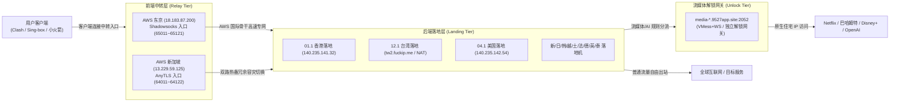
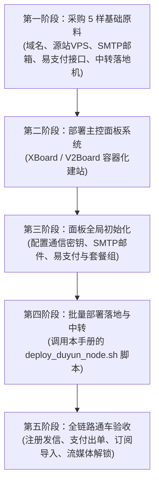

# 渡云模式（Duyun Mode）全网节点部署、架构约定与资产台账全景手册

> **文档定位**：本文档为「渡云网络（duyun88.com）」最核心的运维绝密资产台账与新节点部署 SOP 指南。完整收录了 12 大落地节点真实资产、AWS 双中转转发算法、新节点 5 分钟快速通车命令及 4 级容灾方案。

---

## 一、 渡云模式核心架构全景拓扑

渡云模式采用 **「用户端 ➔ 前端中转 ➔ 后端落地 ➔ 解锁网关」四级解耦高可用架构**：



### 核心架构铁律：
1. **落地机 IP 零泄漏**：客户端只连接 AWS 中转 IP，落地机绝不对外暴露，免疫 GFW 探测与封锁。
2. **双中转热备（Active-Active）**：每个地区落地均同时挂载「JP 中转」与「SG 中转」，任何单台中转被墙，客户端自动无缝漂移，业务不中断。
3. **精准分流解锁**：普通下载与网页浏览由落地机自由出站，仅流媒体与 AI 流量走 2052 端口中转解锁。

---

## 二、 12 大落地节点全景资产台账

渡云全网 12 大落地节点已全部部署 `dy-anytls:55011` 与 `dy-ss:55012` 双协议监听：

| 编号 | 地区 | 节点名称 | 落地机公网 IP / 域名 | 后端 ID (共用) | 媒体解锁配置文件 | 解锁归属地区 | 备注说明 |
| :---: | :---: | :---: | :---: | :---: | :---: | :---: | :--- |
| **01.1** | **HK** | 香港 | `140.235.141.32` | **1011** | `outbound-hk.json` | 香港 (HK) | 原生解 TVB, Viu, Bilibili 港澳台 |
| **02.1** | **SG** | 新加坡 | `141.11.46.113` | **1021** | `outbound-sg.json` | 新加坡 (SG) | 东南亚极速核心骨干 |
| **03.1** | **JP** | 日本 | `151.242.36.4` | **1031** | `outbound-jp.json` | 日本 (JP) | 原生解 Abema, DMM, Niconico |
| **04.1** | **US** | 美国 | `140.235.142.54` | **1041** | `outbound-us.json` | 美国 (US) | 原生解 Hulu, Disney+, Max, OpenAI |
| **05.1** | **KR** | 韩国 | `203.227.191.247` | **1051** | `outbound-us.json` | 美国 (US) | 韩国本土节点 |
| **06.1** | **VN** | 越南 | `103.70.114.20` | **1061** | `outbound-us.json` | 美国 (US) | 东南亚节点 |
| **07.1** | **TR** | 土耳其 | `38.180.112.204` | **1071** | `outbound-us.json` | 美国 (US) | 欧亚低价区节点 |
| **08.1** | **FR** | 法国 | `38.180.226.42` | **1081** | `outbound-us.json` | 美国 (US) | 欧洲大区节点 |
| **09.1** | **DE** | 德国 | `38.180.219.19` | **1091** | `outbound-us.json` | 美国 (US) | 欧洲大区节点 |
| **10.1** | **UK** | 英国 | `38.180.199.40` | **1101** | `outbound-us.json` | 美国 (US) | 英国本土节点 |
| **11.1** | **TH** | 泰国 | `149.33.32.231` | **1111** | `outbound-us.json` | 美国 (US) | 东南亚节点 |
| **12.1** | **TW** | 台湾 | `tw2.fuckip.me` | **1121** | `outbound-tw.json` | 台湾 (TW) | **中华电信 HiNet 动态家宽**，原生解巴哈姆特动画疯、Hami Video |

> [!NOTE]
> **台湾 NAT 端口特别标注**：
> - 台湾节点为内网 NAT 容器，AnyTLS 外部映射端口为 `1491`（对应内部 55011）；Shadowsocks 外部映射端口为 TCP `35517` / UDP `8024`（对应内部 55012）。

---

## 三、 AWS 双中转节点与精准端口转发算法

渡云前台展示的所有入口节点，全部经由 AWS 专用中转服务器进行高速转发：

### 1. 两台中转机基础参数
* **JP 中转机**：`18.183.87.200`（AWS 东京 EC2，slot_no = 1）
* **SG 中转机**：`13.229.59.125`（AWS 新加坡 EC2，slot_no = 2）

### 2. 核心端口映射算法（永不混淆公式）
* **后端主节点 ID**：`1000 + 地区编号(region_no) * 10 + 1`  
  *(例如：HK=1011, SG=1021, JP=1031, US=1041 ... TW=1121)*
* **前端展示入口 ID**：`10000 + 地区编号(region_no) * 10 + slot_no`  
  *(例如：HK 走 JP=10011，HK 走 SG=10012)*
* **中转机监听端口映射规则**：
  * **JP 中转机 (Shadowsocks 入口)**：`65000 + region_no * 10 + 1` ➔ 转发到落地机的 `55012`
  * **SG 中转机 (AnyTLS 入口)**：`64000 + region_no * 10 + 2` ➔ 转发到落地机的 `55011`

### 3. 渡云端口标准对照表
| 协议类型 | 渡云落地监听端口 | 渡云中转入口端口范围 | 协议特性 |
| :--- | :---: | :---: | :--- |
| **AnyTLS** | **`55011`** | **`64011 ~ 64122`** | 强烈推荐！长连接池化复用，抗 GFW 阻断能力极强 |
| **Shadowsocks** | **`55012`** | **`65011 ~ 65121`** | 极速轻量，支持 SS2022，全平台客户端通用 |
| **解锁网关** | **`2052`** | — | VMess+WS 解锁通道（UUID: `bf417eb3-d283-5487-b6ad-9a9be278be8a`） |

---

## 四、 极速开辟全新节点 SOP（两行命令 5 分钟通车）

当你购买了一台新的落地 VPS（如香港、台湾、日本、欧洲等），按以下 3 步即可极速通车：

### 步骤 1：在落地机上执行一键部署（30秒）
登录新买的落地机，执行以下命令：
```bash
bash <(curl -fsSL https://raw.githubusercontent.com/yt77227722-tech/cnode-media-unlock/main/scripts/deploy_duyun_node.sh) \
  -name "TW-HiNet-02" \
  -node_id 1122 \
  -region tw \
  -type both
```
* **参数速查**：
  * `-name`：节点代号（如 `TW-02`、`HK-03`）
  * `-node_id`：渡云面板后端的父节点 ID（如 `1122`）
  * `-region`：流媒体解锁区域（`tw`、`hk`、`us` 或 `general`）
  * `-type`：`both`（同时部署 AnyTLS 和 Shadowsocks）
* 执行后会自动安装 cnode、对接面板、开启 55011/55012 监听，并输出落地机公网 IP。

---

### 步骤 2：在中转机上配置端口转发（10秒）
登录你的 AWS 中转机（或任意一台备用中转机），执行以下命令：
```bash
bash <(curl -fsSL https://raw.githubusercontent.com/yt77227722-tech/cnode-media-unlock/main/scripts/deploy_duyun_relay.sh) \
  -listen 65122 \
  -remote <你的落地机IP>:55011
```
* 自动开启 Linux BBR 加速并配置 Realm 极速端口映射（支持 TCP+UDP）。

---

### 步骤 3：在渡云面板后台（duyun88.com/admin）添加前台节点（1分钟）
1. 登录面板后台 ➔ 点击【节点管理】 ➔ 【新增节点】；
2. **连接地址 (Host)**：填入**中转机的公网 IP**（如 `18.183.87.200` 或中转域名）；
3. **服务端口 (Port)**：填入**中转端口**（如 `65122`）；
4. **内部服务端口**：填入**落地端口**（如 `55011`）；
5. **父节点 ID (Parent ID)**：选择步骤 1 中填写的后端节点 ID（如 `1122`）；
6. 保存后，客户端刷新订阅，全新线路立刻全网通车！🎉

---

## 五、 解锁中转网关（media-*.9527app.site:2052）灾备自建与恢复

如果上游解锁网关（`media-*.9527app.site:2052`）故障或掉线，如何快速恢复？

### 步骤 1：在任意一台具有原生解锁能力的 VPS 上一键自建新网关
```bash
bash <(curl -fsSL https://raw.githubusercontent.com/yt77227722-tech/cnode-media-unlock/main/scripts/deploy_media_gateway.sh)
```
* 自动在 `0.0.0.0:2052` 启动 VMess+WS 网关，将请求以本机原生 IP 直连外网。

### 步骤 2：秒级全网恢复
* **方案 A（改 DNS，推荐）**：在 Cloudflare 将 `media-hk-*.9527app.site`（或你自定的域名）A 记录指向新网关 IP。**全网所有落地节点 0 改动，秒级无缝恢复！**
* **方案 B（改配置）**：将你的域名写入 GitHub 仓库的 `config/outbound-*.json`，落地机执行 `systemctl restart cnode` 即可。

---

## 六、 4 级阶梯式容灾切换手则（保证业务 100% 不掉线）

| 故障场景 | 容灾级别 | 操作方法 | 生效耗时 | 对用户的影响 |
| :--- | :---: | :--- | :---: | :---: |
| **单台 AWS 中转被墙/宕机** | **第 1 级** | 无需操作！客户端默认配置了 JP/SG 双中转，客户端自动漂移至备选中转 | 0 秒 | 完全无感 |
| **AWS 中转 IP 被 GFW 阻断** | **第 2 级** | 登录 AWS EC2 控制台 ➔ Elastic IPs ➔ 分配并绑定新弹性 IP ➔ 释放旧 IP ➔ 更新面板 Host 或修改中转域名解析 | 30 秒 | 刷新订阅即恢复 |
| **AWS 整体故障/不想用 AWS** | **第 3 级** | 拿任意一台小鸡运行 `deploy_duyun_relay.sh` 转发到落地机，面板 Host 改为该小鸡 IP | 1 分钟 | 刷新订阅即恢复 |
| **所有中转全挂（紧急救援）** | **第 4 级** | 登录渡云后台，将节点的连接地址（Host）直接改成**落地机真实 IP**，降级为直连模式 | 10 秒 | 瞬间全网通车 |

---

## 七、 渡云源站架构、数据库与日常运维命令

### 1. 渡云源站配置底账
* **源站 IP**：`38.59.230.13`（SSH: root:22，公钥认证）
* **管理后台**：`https://duyun88.com/04ff1ba4`（管理员邮箱: `tinger231@gmail.com`）
* **运行架构**：Docker Compose (`/opt/lnmpr/docker-compose.yaml`) 托管 Nginx + PHP 8.3 + MariaDB + Redis
* **在线源码**：`/opt/lnmpr/www/v2_dy`（xv2board v1.7.5）
* **数据库名**：`v2_dy`（容器内执行：`docker exec -it mariadb sh -lc 'mariadb -uroot -p"$MARIADB_ROOT_PASSWORD" v2_dy'`）
* **自动备份**：每天凌晨 03:00 自动打包并推送最新备份到 Telegram

### 2. 日常排查命令速查
```bash
# 落地机查看 cnode 状态与心跳日志
systemctl status cnode
journalctl -u cnode -f -n 50
systemctl restart cnode

# 中转机查看 Realm 端口转发状态
systemctl status duyun-relay
journalctl -u duyun-relay -f -n 50

# 查看当前中转连接并发数
netstat -nat | grep ESTABLISHED | wc -l
```

---

## 八、 永久 GitHub 资源调用直链

* **GitHub 仓库主页**：[`https://github.com/yt77227722-tech/cnode-media-unlock`](https://github.com/yt77227722-tech/cnode-media-unlock)
* **落地机一键部署脚本**：
  `https://raw.githubusercontent.com/yt77227722-tech/cnode-media-unlock/main/scripts/deploy_duyun_node.sh`
* **中转机一键转发脚本**：
  `https://raw.githubusercontent.com/yt77227722-tech/cnode-media-unlock/main/scripts/deploy_duyun_relay.sh`
* **独立解锁网关一键脚本**：
  `https://raw.githubusercontent.com/yt77227722-tech/cnode-media-unlock/main/scripts/deploy_media_gateway.sh`
* **全套解锁配置目录**：
  `https://github.com/yt77227722-tech/cnode-media-unlock/tree/main/config`

---

## 九、 从 0 到 1 克隆/新建一套全新“渡云级”系统全流程准备与建站指南（Genesis Blueprint）

如果你打算**完全脱离渡云**，或者**打造一个属于自己的全新加速器品牌（新站点、新域名、独立用户与财务系统）**，直接按照以下六大板块准备与执行即可：



---

### 板块 1：前期必备的 5 样资产与原料清单

在动手安装系统前，必须提前准备好以下 5 项基础资产：

| 资产类别 | 规格与建议选型 | 用途与作用 | 推荐服务商 / 获取途径 |
| :--- | :--- | :--- | :--- |
| **1. 业务域名** | 1 个独立顶尖域名（如 `.com`、`.top`、`.net`） | 用户访问的前端站点、后台管理与客户端订阅拉取入口 | Namesilo、Cloudflare Registrar（DNS 统一托管到 Cloudflare 免费版） |
| **2. 面板源站 VPS** | **2核 4G 内存**，系统推荐 Ubuntu 22.04 LTS 或 Debian 12 | 托管业务网站、用户数据库（MariaDB）、Redis 快取与异步任务队列 | 搬瓦工、DMIT、OVH、RackNerd 等海外高防/稳定机房（每月约 \$5 ~ \$15） |
| **3. 发信 SMTP 服务** | 支持标准 SMTP 协议的发信账号 | 用户注册验证码、找回密码、到期续费提醒、工单通知 | • **阿里云国际/国内邮件推送 (DirectMail)**：便宜好用<br>• **AWS SES**：性价比极高（\$0.10/千封）<br>• **Resend / Brevo**：轻量快捷 |
| **4. 在线支付网关** | 兼容 **易支付（EPay 协议）** 的聚合接口或 USDT 免签 | 用户在线扫码购买套餐（支付宝 / 微信 / USDT）并自动实时开通激活 | • 国内/海外聚合易支付商户（提供 API 网关、商户 ID 与 KEY）<br>• **Epusdt**（开源自建 TRC20 USDT 自动收款） |
| **5. 中转与落地 VPS** | • **中转 VPS**：1~2 台（AWS EC2 东京/新加坡，或国内优质移动/BGP 转发机）<br>• **落地 VPS**：按需采购（香港、台湾、日本、美国等，至少备 1~2 台） | • 中转负责入口加速与保护真实 IP<br>• 落地负责提供真实出站流量与流媒体解锁 | 各大 VPS 商家（落地机可买超便宜 NAT 机；中转机看重对大陆直连延迟） |

---

### 板块 2：源站主控面板（XBoard / V2Board）一键部署 SOP

在新买的**面板源站 VPS** 上执行以下标准化建站流程（以现代标准容器化 XBoard 为例）：

#### 1. 安装基础依赖与 Docker
```bash
# 更新系统并安装 Docker 环境
curl -fsSL https://get.docker.com | bash
systemctl enable --now docker
apt-get install -y curl git jq docker-compose-plugin
```

#### 2. 一键创建 XBoard 容器栈目录
```bash
mkdir -p /opt/xboard && cd /opt/xboard

# 编写 docker-compose.yml 配置文件
cat > docker-compose.yml <<EOF
version: '3.8'

services:
  web:
    image: cedar2025/xboard:latest
    container_name: xboard-web
    restart: always
    volumes:
      - ./.env:/www/.env
      - ./data:/www/data
    ports:
      - "7001:7001"
    depends_on:
      - mariadb
      - redis

  mariadb:
    image: mariadb:10.11
    container_name: xboard-mariadb
    restart: always
    environment:
      MYSQL_ROOT_PASSWORD: MyStrongPassword2026!
      MYSQL_DATABASE: xboard
      MYSQL_USER: xboard
      MYSQL_PASSWORD: MyStrongPassword2026!
    volumes:
      - ./mariadb_data:/var/lib/mysql

  redis:
    image: redis:7-alpine
    container_name: xboard-redis
    restart: always
    volumes:
      - ./redis_data:/data
EOF
```

#### 3. 执行初始化与创建管理员
```bash
# 启动容器并执行系统初始化安装向导
docker compose up -d
docker compose exec web php artisan xboard:install

# 根据终端提示输入：
# - 数据库地址: mariadb
# - 数据库用户名: xboard
# - 数据库密码: MyStrongPassword2026!
# - 管理员邮箱与密码（用于登录后台）
```

#### 4. 配置 Nginx 反向代理与 SSL 证书
在 Cloudflare 将你的域名解析到该源站 VPS IP（开启小黄云 CDN 保护），源站反代 `127.0.0.1:7001` 即可安全交付！

---

### 板块 3：面板核心参数初始化设定（关键 4 步）

登录新网站管理后台（`https://你的域名/admin`），进行核心参数设定：

1. **设置全局节点通讯密钥（`Server Token / API Key`）**：
   * 路径：【系统配置】 ➔ 【节点与协议配置】 ➔ 【通讯密钥】；
   * 自定义一串高强度随机密钥（例如 `MySuperKey2026Secret999`）；
   * **作用**：后续所有落地机连接该面板时，全部使用这个统一密钥！
2. **配置 SMTP 发信邮箱**：
   * 路径：【系统配置】 ➔ 【邮件配置】；
   * 填入发信服务器、端口（通常 465 SSL 或 587 TLS）、账号与密码，点击【发送测试邮件】验证成功。
3. **配置易支付通道**：
   * 路径：【系统配置】 ➔ 【支付配置】 ➔ 【新增支付方式】 ➔ 选择 **EPay 易支付**；
   * 填入网关地址（如 `https://pay.xxx.com/submit.php`）、商户 ID 与商户通信密钥。
4. **套餐体系规划（分组隔离）**：
   * 建立权限组：`Group 1`（基础组）、`Group 2`（高级组）；
   * 创建商品套餐：
     * **基础套餐（VIP1）**：绑定 `Group 1`，包含香港、新加坡、美国普通节点；
     * **旗舰套餐（VIP2）**：绑定 `Group 2`，包含台湾原生家宽、流媒体独享大带宽专线。

---

### 板块 4：批量开通与接入节点（直接调用本手册工具）

新站点建好后，接入节点的步骤**与渡云模式完全一致**，直接使用本手册前面封装好的脚本：

#### 1. 落地机部署：
登录新买的任意海外落地小鸡，执行：
```bash
bash <(curl -fsSL https://raw.githubusercontent.com/yt77227722-tech/cnode-media-unlock/main/scripts/deploy_duyun_node.sh) \
  -api_host "https://你的新主站域名.com" \
  -api_key "你在第3步设定的通讯密钥" \
  -name "HK-Node-01" \
  -node_id 1011 \
  -region hk \
  -type both
```

#### 2. 中转机端口转发：
登录你的中转机（AWS EC2 或其他中转机），执行：
```bash
bash <(curl -fsSL https://raw.githubusercontent.com/yt77227722-tech/cnode-media-unlock/main/scripts/deploy_duyun_relay.sh) \
  -listen 65011 \
  -remote <新落地机IP>:55011
```

#### 3. 面板录入节点：
* 进入新面板后台 ➔ 【节点管理】 ➔ 【新增节点】；
* 填入中转机 IP 与中转端口 `65011`，关联后端父节点 ID `1011`，保存即刻通车！

---

### 板块 5：新站全链路交付验收核对表（Checklist）

在正式对外发布前，逐一核对以下 5 项指标：

- [ ] **1. 用户端注册**：前台注册新账号，能准时收到邮件验证码。
- [ ] **2. 订单与在线支付**：使用测试账号下单一笔，扫码支付后，后台订单秒级自动变为“已完成”，流量套餐自动入账。
- [ ] **3. 订阅分发正常**：点击【一键导入 Clash / Sing-box / 小火箭】，客户端能正常下载节点配置且不报错。
- [ ] **4. 代理网络握手成功**：客户端启动代理，访问 `https://ip.sb` 显示为落地机地区 IP，延迟与测速达标。
- [ ] **5. 流媒体与 AI 解锁通关**：打开 YouTube（正常秒开）、Netflix（能看非自制剧）、巴哈姆特动画疯（台湾节点 200 解锁）、ChatGPT / Claude（正常对话无阻断）。

