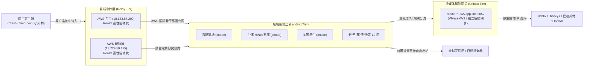

# 渡云模式（Duyun Mode Matrix）全链路架构与运维 SOP

本文档完整记录「渡云网络」高可用代理矩阵的核心拓扑架构、新建节点标准化流程（SOP）与 4 级灾备恢复策略。所有配置与一键脚本均已同步托管于本 GitHub 仓库，可在任何新 VPS 上直接调取。

---

## 一、 渡云模式架构总览

渡云模式采用业界领先的 **「客户端 ➔ 前端中转 ➔ 后端落地 ➔ 解锁网关」四级解耦高可用架构**：



### 核心设计原则：
1. **落地机 IP 零泄漏**：用户客户端只直连 AWS 中转机，高价值的原生家宽与流媒体落地机永远隐藏在幕后，免疫 GFW 探测与封锁。
2. **双中转热备（Active-Active）**：每个地区落地均同时挂载「JP 中转」与「SG 中转」，任何单台中转故障，客户端秒级平滑切换，服务不中断。
3. **分流精准解锁**：普通大带宽流量（下载、网页）直接从落地机出站，不消耗解锁网关流量；仅流媒体（Netflix/巴哈姆特/OpenAI）走 2052 端口中转解锁。

---

## 二、 端口与协议规范标准

| 角色 | 协议类型 | 典型监听端口区间 | 职能说明 |
| :--- | :--- | :--- | :--- |
| **落地机 (cnode)** | **AnyTLS** | `55001 ~ 55999` | 抗封锁首选，长连接会话池复用，极低握手延迟 |
| **落地机 (cnode)** | **Shadowsocks** | `54001 ~ 54999` | 经典高效协议，支持 SS2022，适配全平台客户端 |
| **中转机 (Relay)** | **Realm (TCP+UDP)** | `64001 ~ 65999` | 将中转机端口零拷贝高速映射到落地机的内部服务端口 |
| **解锁网关 (Gateway)** | **VMess + WS** | `2052` | 统一密钥：`bf417eb3-d283-5487-b6ad-9a9be278be8a` |

---

## 三、 开辟一条全新节点的标准 SOP（极速 5 分钟通车）

当你购买了一台新的海外 VPS（例如新购一台台湾、香港或欧洲小鸡），只需按照以下 3 步即可将其对接到渡云网络：

### 第一步：在落地机上执行一键部署（30秒）
登录新买的落地机，直接执行这行命令：
```bash
bash <(curl -fsSL https://raw.githubusercontent.com/yt77227722-tech/cnode-media-unlock/main/scripts/deploy_duyun_node.sh) \
  -name "TW-HiNet-02" \
  -node_id 1122 \
  -region tw \
  -type both
```
* **参数说明**：
  * `-name`：节点英文代号
  * `-node_id`：渡云面板后端的父节点 ID
  * `-region`：流媒体解锁区域（`tw`、`hk`、`us` 或 `general`）
  * `-type`：`both`（同时部署 AnyTLS 和 Shadowsocks）
* **脚本输出**：会自动打印落地机的公网 IP 与运行状态。

---

### 第二步：在中转机上配置端口转发（10秒）
登录你的 AWS 中转机（或任意一台具有良好大陆连接的中转机），执行这行命令：
```bash
bash <(curl -fsSL https://raw.githubusercontent.com/yt77227722-tech/cnode-media-unlock/main/scripts/deploy_duyun_relay.sh) \
  -listen 65122 \
  -remote <你的落地机IP>:55011
```
* 该脚本会自动开启 Linux 内核 BBR 优化，并用轻量高效的 Realm 配置好 TCP+UDP 双向转发。

---

### 第三步：在渡云面板后台（duyun88.com/admin）添加前台节点（1分钟）
1. 登录面板后台 ➔ 点击【节点管理】 ➔ 【新增节点】；
2. **基础设置**：
   * **节点名称**：`台湾 2X|HiNet[AnyTLS]`
   * **权限组**：根据套餐选择 `组 1 (VIP1)` 或 `组 2 (VIP2)`
   * **倍率**：`1.0`
3. **连接设置**：
   * **连接地址 (Host)**：填写**中转机的公网 IP**（如 `18.183.87.200` 或中转域名）
   * **服务端口 (Port)**：填写**中转端口**（如 `65122`）
   * **父节点 ID (Parent ID)**：选择第一步部署时填写的后端节点（如 `1122`）
4. 保存后，客户端刷新订阅，全新节点立刻通车！🎉

---

## 四、 4 级容灾切换手则（保证业务 100% 不掉线）

| 故障场景 | 容灾级别 | 操作方法 | 生效耗时 | 对用户的影响 |
| :--- | :---: | :--- | :---: | :---: |
| **单台 AWS 中转被墙/宕机** | **第 1 级** | 无需操作！渡云客户端默认配置了 JP/SG 双中转，客户端自动漂移至备选中转 | 0 秒 | 完全无感 |
| **AWS 中转 IP 被 GFW 阻断** | **第 2 级** | 登录 AWS EC2 控制台 ➔ Elastic IPs ➔ 分配并绑定新弹性 IP ➔ 释放旧 IP ➔ 更新面板 Host 或修改中转域名解析 | 30 秒 | 刷新订阅即恢复 |
| **AWS 整体故障/不想用 AWS** | **第 3 级** | 拿任意一台小鸡运行 `deploy_duyun_relay.sh` 转发到落地机，面板 Host 改为该小鸡 IP | 1 分钟 | 刷新订阅即恢复 |
| **所有中转全挂（紧急救援）** | **第 4 级** | 登录渡云后台，将节点的连接地址（Host）直接改成**落地机真实 IP**，降级为直连模式 | 10 秒 | 瞬间全网通车 |

---

## 五、 常用运维与故障排查命令速查

### 1. 落地机日常检查
```bash
# 查看 cnode 运行状态与面板心跳日志
systemctl status cnode
journalctl -u cnode -f -n 50

# 重启 cnode 重新加载规则
systemctl restart cnode
```

### 2. 中转机日常检查
```bash
# 查看 Realm 端口转发状态
systemctl status duyun-relay
journalctl -u duyun-relay -f -n 50

# 查看当前活跃网络连接数
netstat -nat | grep ESTABLISHED | wc -l
```

### 3. 解锁网关日常检查
```bash
# 查看独立解锁网关状态
systemctl status media-gateway
```
